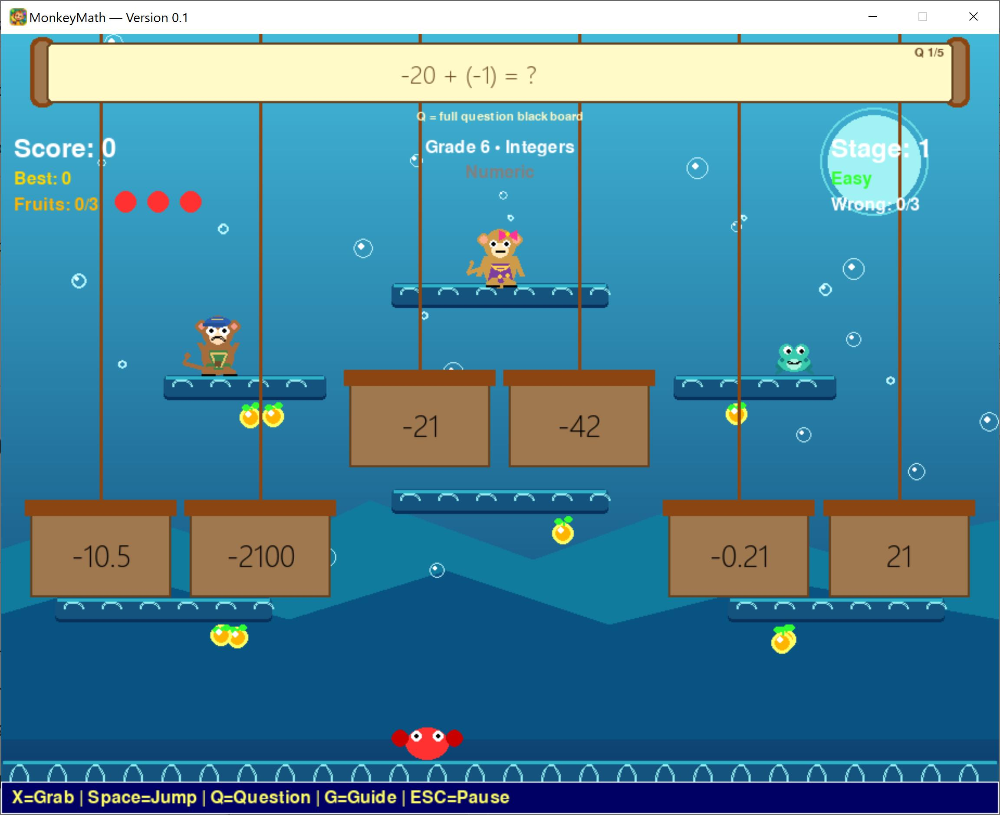

# Monkey Math 🐒🍌

**Monkey Math** is a fun 2D educational platform game that combines mathematics, exploration, and action! Help the monkey solve math problems, collect fruits, dodge crabs, and deliver the correct answers.

With **25 math courses**, learner profiles, progress tracking, and increasingly challenging questions, Monkey Math offers a playful way to practise mathematics—from school arithmetic to advanced college-level topics.

## 🎮 Gameplay

- **25 math courses:** Choose from a collection of school and college mathematics courses. Some courses are disabled in this public release and will become available in future updates.
- **Learner profiles:** Create or select a learner profile.
- **Separate progress tracking:** Track learning progress independently for each learner and course.
- **Three lives:** The monkey starts each run with three lives.
- **Fruit collecting:** Jump around the level to collect fruits.
- **Fruit throwing:** Throw fruits at crabs to stun them.
- **Progressive challenges:** The challenge increases as you advance through the stages.
- **Armored crab:** This tougher enemy requires two fruit hits to be stunned.
- **Friendly frog:** Meet the funny frog that can appear throughout the stages. The frog is harmless and cannot hurt the monkey!
- **Hints:** Press `G` during gameplay to get help with a question.
- **Character customization:** Customize your character through the wardrobe.
- **Theme and sound settings:** Personalize the game experience through Settings.

## ⌨️ Keyboard Controls

### Main menu

| Key | Action |
|---|---|
| `Enter` | Confirm a selection or start the selected course |
| `L` | Open course selection |
| `P` | Select or create a learner profile |
| `D` | Open the learning progress dashboard |
| `C` | Open character customization |
| `A` | Open About |
| `S` | Open Settings |

Use the arrow keys to navigate menus and `Enter` to confirm a selection.

### During gameplay

| Key | Action |
|---|---|
| `←` / `→` | Move the monkey left or right |
| `Space` | Jump |
| `Z` | Throw a fruit |
| `X` | Select or grab an answer scroll |
| `T` | Enter an answer using the keyboard |
| `G` | Show a hint |
| `R` | Restart the current level |
| `M` | Toggle background music or ambient sound |
| `N` | Toggle all sounds |
| `Esc` | Pause or resume the game |

When using keyboard answer entry, type your answer and press `Enter` to submit it. Follow the on-screen prompts to leave answer-entry mode.

### Learner profiles and progress

- Press `P` from the main menu to choose an existing learner or create a new profile.
- Use the arrow keys to navigate the profile selector and follow the on-screen instructions to confirm or create a profile.
- Press `D` from the main menu to open the progress dashboard.
- Use the dashboard controls to browse course progress and switch learners.
- Press `Esc` to return to the previous screen.

### Settings

- Press `S` from the main menu to open Settings.
- Use the arrow keys to navigate the available options.
- Press `Enter` to select or toggle an option.
- Press `Esc` to leave Settings.

## 🧮 Mathematics and Learning

Monkey Math includes **25 planned math courses**, covering a range of school and college-level mathematics topics.

**Please note:** Some courses are disabled in this initial public release. They are part of the broader course collection and may be enabled in future updates.

Learner profiles help keep learning progress separate, allowing multiple learners to use the same computer.

## 📦 Download and Installation

**Monkey Math v0.1** is available as a standalone Windows executable through GitHub Releases.

1. Visit the [Monkey Math v0.1 Release](https://github.com/ostad-ai/MonkeyMath/releases/tag/v0.1).
2. Download the Windows 64-bit release archive.
3. Extract the archive if it is packaged as a ZIP file.
4. Run `monkeymath.exe`.

**System requirement:** Windows 10 or later (64-bit).

A separate Python installation is not required to run the standalone executable.

## 🆕 What's New in Version 0.1

**Version 0.1 is the second public release of Monkey Math!**

Highlights include:

- **25 math courses** in the course collection, with some courses disabled in this release.
- Learner profiles and separate progress tracking for each learner and course.
- A learning progress dashboard.
- Character customization through the wardrobe.
- Platforming gameplay with jumping, fruit collecting, and fruit throwing.
- Crab enemies, including the armored crab.
- **A funny, harmless frog** that can appear throughout the stages—new in v0.1!
- Keyboard-based answer entry and question hints.
- Theme and sound settings.
- A standalone Windows 64-bit executable distributed through GitHub Releases.

## ⭐ Support Monkey Math

If you enjoy Monkey Math, please consider **starring ⭐ this GitHub repository** and giving the project a **👍 like**. Your support helps the project reach more players and encourages future improvements. Thank you for playing!

## 💡 Inspiration

The idea behind Monkey Math was inspired by an older game and reimagined as an educational experience that combines mathematics practice with platforming fun.

---

**Have fun learning, collecting fruits, dodging crabs, and meeting the friendly frog!** 🐒🍌🐸
---

<table>
  <tr>

<td>
Figure 1: A snapshot of MonkeyMath Game at level one, version 0.0.0.0, while playing the game.</td>
    
<td>
Figure 2: A snapshot of MonkeyMath Game, version 0.1, while playing the game.</td>

  </tr>
</table>

---
