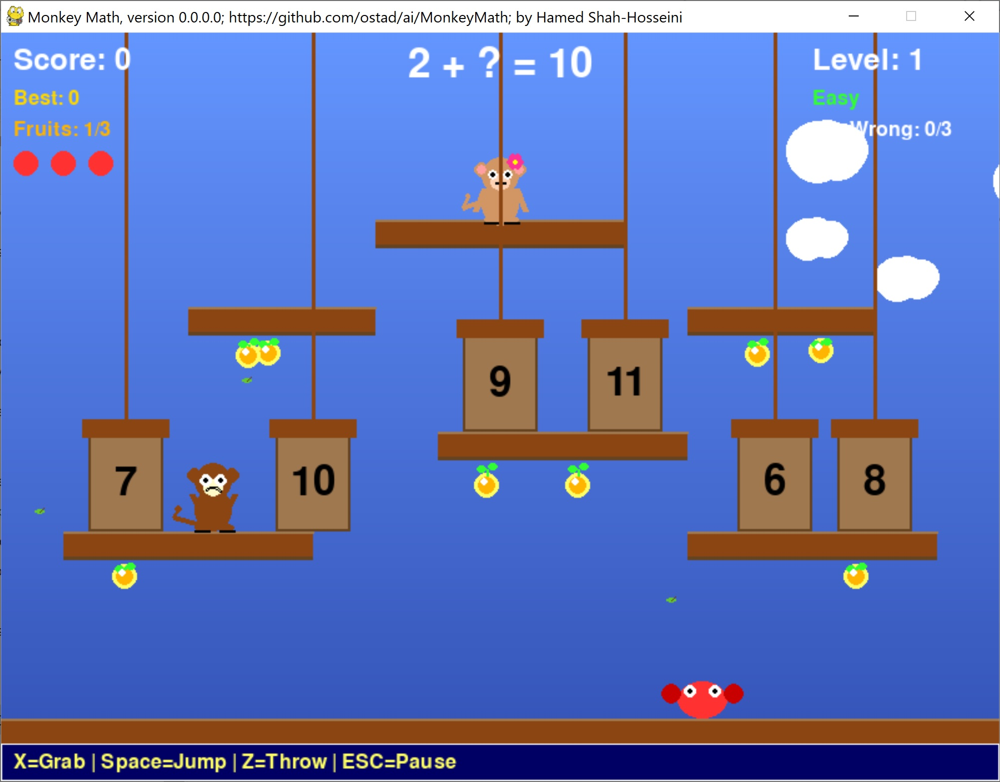
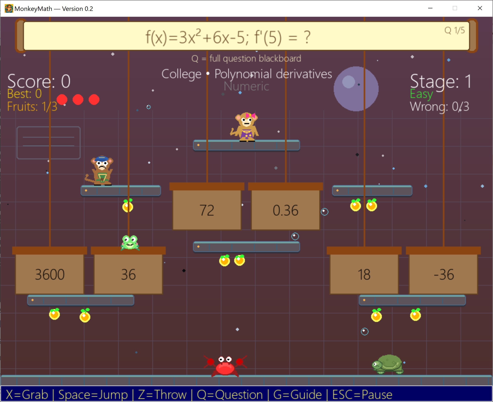
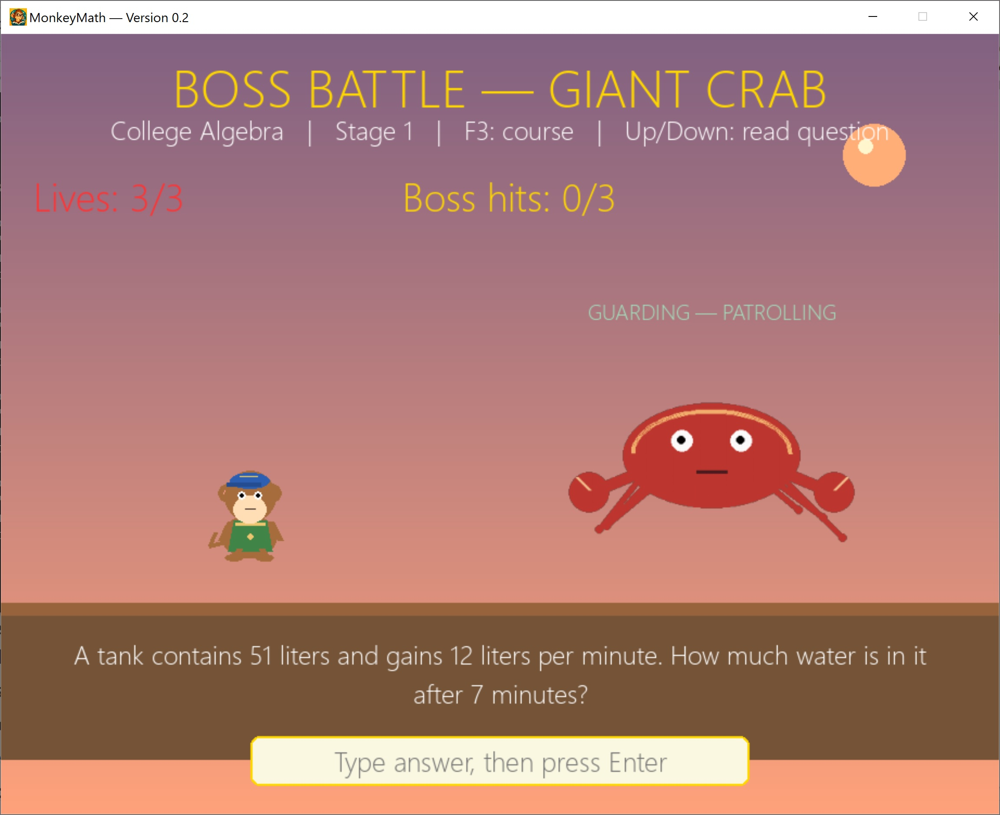

# Monkey Math 🐒🍌

**Monkey Math** is a fun 2D educational platform game that combines mathematics, exploration, and action! Help the monkey solve math problems, collect fruits, dodge crabs, and deliver the correct answers.

With **25 math courses**, learner profiles, separate progress tracking, and increasingly challenging questions, Monkey Math offers a playful way to practise mathematics—from school arithmetic to advanced college-level topics.

Version **0.2** adds two dedicated ways to practise mathematics—**Professor Mode** and **Boss Battle**—and brings a friendly turtle into the adventure.

## 🎮 Gameplay

- **25 math courses:** Choose from a collection of school and college mathematics courses. Some courses are disabled in this public release and may become available in future updates.
- **Learner profiles:** Create or select a learner profile.
- **Separate progress tracking:** Track learning progress independently for each learner and course.
- **Three lives:** The monkey starts each Adventure run with three lives.
- **Fruit collecting:** Jump around the level to collect fruits.
- **Fruit throwing:** Throw fruits at crabs to stun them.
- **Progressive challenges:** The challenge increases as you advance through the stages.
- **Armored crab:** This tougher enemy requires two fruit hits to be stunned.
- **Friendly frog:** Meet the funny frog that can appear throughout the stages. The frog is harmless and cannot hurt the monkey!
- **Friendly turtle:** A harmless turtle sometimes wanders across the ground platform. When the monkey or a nearby crab approaches, it can tuck its head into its shell.
- **Hints:** Press `G` during Adventure gameplay to get help with a question.
- **Character customization:** Customize your character through the wardrobe.
- **Theme and sound settings:** Personalize the game experience through Settings.

## 🧑‍🏫 Game Modes

### Adventure Mode

The main platforming adventure combines math questions with jumping, collecting fruit, avoiding crabs, and progressing through stages. The in-game Question Blackboard offers guidance; complete worked solutions are available in Professor Mode.

### Professor Mode — New in v0.2

Professor Mode is a dedicated study session for guided explanations and mathematics practice. Choose a learner profile and an available course to begin. You can request hints, reveal a solution, and review the teaching material while working through questions. Practice difficulty can adjust gradually based on the learner's recent unassisted first answers.

### Boss Battle — New in v0.2

Take on the **Giant Crab** in a separate math battle. Solve questions to land hits and defeat the crab with **three successful answers**. The crab announces attacks, giving you a chance to answer correctly and counter before an attack lands. You have **three lives** in the battle. Choose a learner profile and an available course before starting.

## ⌨️ Keyboard Controls

### Main menu

| Key | Action |
|---|---|
| `Enter` | Confirm a selection or start Adventure Mode for the selected course |
| `L` | Open course selection |
| `P` | Select or create a learner profile |
| `D` | Open the learning progress dashboard |
| `C` | Open character customization |
| `A` | Open About |
| `S` | Open Settings |
| `T` | Start Professor Mode |
| `B` | Start Boss Battle |

Use the arrow keys to navigate menus and `Enter` to confirm a selection.

### During Adventure Mode

| Key | Action |
|---|---|
| `←` / `→` | Move the monkey left or right |
| `Space` | Jump (double jump is also available) |
| `Z` | Throw a fruit |
| `X` | Select or grab an answer scroll |
| `T` | Enter an answer using the keyboard |
| `G` | Show a hint |
| `R` | Restart the current level |
| `M` | Toggle background music or ambient sound |
| `N` | Toggle all sounds |
| `Esc` | Pause or resume the game |

When using keyboard answer entry, type your answer and press `Enter` to submit it. Follow the on-screen prompts to leave answer-entry mode.

### Professor Mode

| Key | Action |
|---|---|
| Type an answer, then `Enter` | Check your answer |
| `F1` | Reveal a hint |
| `F2` | Reveal the worked solution |
| `↑` / `↓` | Scroll the teaching material |
| `Page Up` / `Page Down` | Scroll the teaching material faster |
| `Ctrl` + `N` | Move to the next question |
| `Ctrl` + `E` | Export available aggregate difficulty observations to a CSV file |
| `Backspace` | Delete the last character in your answer |
| `Esc` | Return to the main menu |

### Boss Battle

| Key | Action |
|---|---|
| Type an answer, then `Enter` | Submit your answer and attempt to hit or counter the Giant Crab |
| `↑` / `↓` | Scroll the question |
| `Page Up` / `Page Down` | Scroll the question faster |
| `F3` | Open course selection without leaving the battle |
| `Backspace` | Delete the last character in your answer |
| `Esc` | Return to the main menu |

### Learner profiles and progress

- Press `P` from the main menu to choose an existing learner or create a new profile.
- Use the arrow keys to navigate the profile selector and follow the on-screen instructions to confirm or create a profile.
- Press `D` from the main menu to open the progress dashboard.
- Use the dashboard controls to browse course progress and switch learners.
- Press `Esc` to return to the previous screen.

### Settings

- Press `S` from the main menu to open Settings.
- Use the arrow keys to navigate the available options.
- Press `Enter` to select or toggle an option.
- Press `Esc` to leave Settings.

## 🧮 Mathematics and Learning

Monkey Math includes **25 math courses**, covering a range of school and college-level mathematics topics.

**Please note:** Some courses are disabled in this public release. They are part of the broader course collection and may be enabled in future updates.

Learner profiles help keep learning progress separate, allowing multiple learners to use the same computer. Professor Mode provides guided explanations, hints, and worked solutions; the main Adventure Question Blackboard provides guidance without displaying the complete solution.

## 📦 Download and Installation

**Monkey Math v0.2** is available as a standalone onefile Windows executable through GitHub Releases.

1. Visit the [Monkey Math v0.2 Release](https://github.com/ostad-ai/MonkeyMath/releases/tag/v0.2).
2. Download the Windows 64-bit executable.
3. Run `monkeymath.exe`.

**System requirement:** Windows 10 or later (64-bit).

A separate Python installation is not required to run the standalone executable.

## 🆕 What's New in Version 0.2

Version 0.2 builds on the platforming adventure introduced in the first public release. Highlights include:

- **Professor Mode:** A dedicated learning mode with guided explanations, hints, worked solutions, and gradually adaptive practice difficulty.
- **Boss Battle:** Face the Giant Crab, answer mathematics questions, counter its attacks, and land three successful hits to win.
- **A friendly turtle:** A harmless turtle now wanders across the ground platform and hides in its shell when the monkey or a nearby crab approaches.
- The 25-course collection, learner profiles, and separate progress tracking remain part of the game; some courses are still disabled in this public release.
- Adventure Mode continues to feature jumping, fruit collecting, fruit throwing, crab enemies (including the armored crab), and the friendly frog.
- Character customization, hints, and theme and sound settings.
- A standalone Windows 64-bit executable distributed through GitHub Releases.

## ⭐ Support Monkey Math

If you enjoy Monkey Math, please consider **starring ⭐ this GitHub repository** and giving the project a **👍 like**. Your support helps the project reach more players and encourages future improvements. Thank you for playing!

---

**Have fun learning, collecting fruits, dodging crabs, meeting the friendly frog and turtle, studying with Professor Mode, and challenging the Giant Crab!** 🐒🍌🐸🐢

---

<table>
  <tr>
    <td>
    Figure 1: A snapshot of MonkeyMath Game at level one, version 0.0.0.0, while playing the game.</td>
    <td>
    Figure 2: A snapshot of MonkeyMath Game, version 0.1, while playing the game.</td>
  </tr>
<tr>
<td>

    Figure 3: A snapshot of MonkeyMath Game, version 0.2, while playing the game in <b>Adventure Mode</b>.
</td>
<td>

    Figure 4: A snapshot of MonkeyMath Game, version 0.2, while playing the game in <b>Boss Battle</b>.
</td>
</td>
</tr>

</table>

---
